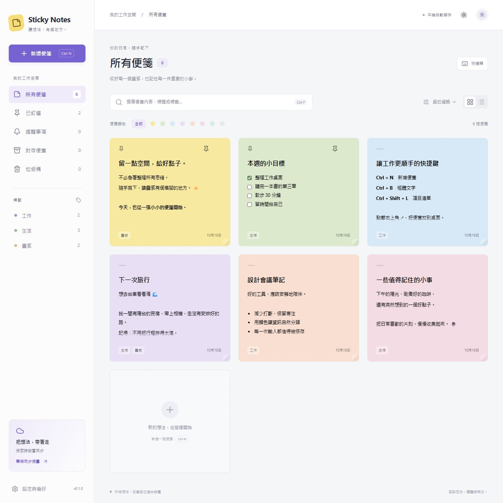

# Sticky Notes 自黏便箋

以 `C:\dev\vm_shared\tauri-app-template` 的 React 19 + TypeScript + Tauri 2 範本為基底，建立本機優先的繁體中文便箋應用。

## 開發與執行

需求：Node.js、pnpm、Rust，以及 Tauri 對應平台的建置工具（Windows 使用 WebView2 / MSVC）。

```powershell
pnpm install
pnpm dev            # 瀏覽器預覽，http://localhost:1420
pnpm tauri:dev      # 桌面開發模式
pnpm build         # TypeScript + 前端正式建置
pnpm tauri:build    # 於目前作業系統建置安裝包
```

Tauri 必須在各自平台建置。此版本在 Windows 驗證，macOS / Linux 尚未實機驗證。Android / iOS 與 Widget 不在此版交付範圍。

## 已實作

- 工作板：八色便箋、釘選、封存、標籤、即時內容搜尋、顏色篩選、網格／清單與排序。
- 編輯器：粗體、斜體、底線、刪除線、待辦清單、項目／編號清單、字級縮放、四種隨主題切換的文字標注。
- 圖片：貼上或選取圖片（單張 8 MB），選取圖片後縮放、刪除、另存。
- 外觀：淺色、深色、系統主題；依紙張相對亮度選用黑／白文字。
- 桌面：每張便箋可開啟獨立視窗、置頂、主視窗關閉至系統匣、單一應用實例。
- 儲存：180 ms 防抖自動儲存，Rust + SQLite（WAL / synchronous FULL）；瀏覽器預覽使用 IndexedDB。
- 垃圾桶：還原、永久刪除確認，啟動時清除已刪除超過 30 天的便箋。
- 提醒：日期時間、5 / 15 / 30 / 60 分鐘後、到期主視窗顯示並置頂、閃爍、提示音、自訂 1 MB 以下音訊、延後 10 分鐘。
- 防窺：4 位數 PIN（隨機 salt + SHA-256），鎖定便箋不在總表／搜尋顯示內文或標題。
- 智慧連結：網址、Email、電話、結構化日期、台灣格式街道地址。日期可帶入提醒，地址使用 Google Maps。
- 匯出：單張 Markdown、JSON、透過系統列印另存 PDF；全部 JSON 備份與匯入（匯入為新便箋）。

## 快捷鍵

| 操作 | Windows / Linux | macOS |
| --- | --- | --- |
| 新增 | Ctrl+N | ⌘+N |
| 刪除目前便箋 | Ctrl+D | ⌘+D |
| 總清單 | Ctrl+H | ⌘+H |
| 搜尋 | Ctrl+F | ⌘+F |
| 粗體／斜體／底線 | Ctrl+B / I / U | ⌘+B / I / U |
| 刪除線 | Ctrl+T | ⌘+T |
| 項目清單 | Ctrl+Shift+L | ⌘+Shift+L |
| 字級放大／縮小 | Ctrl+Shift+> / < | ⌘+Shift+> / < |
| 全域新增（桌面） | Ctrl+Alt+N | ⌘+Alt+N |
| 全域喚醒（桌面） | Ctrl+Alt+H | ⌘+Alt+H |

全域快捷鍵加上 Alt，避免攔截其他應用程式的基本操作。若已被其他程式占用，應用會顯示註冊失敗訊息。

## 資料位置與限制

SQLite 位於 Tauri `app_data_dir()/sticky-notes.sqlite3`，Windows 通常為 `%APPDATA%\com.david136755.stickynotes\sticky-notes.sqlite3`。備份請使用設定中的 JSON 匯出，確保包含 WAL 中已提交的資料。

防窺鎖只用於畫面遮蔽，不是資料加密。資料庫、圖片與 JSON 備份含明文內容。提醒需要程式持續執行；關機期間無法通知，恢復執行後會補顯示逾期提醒。瀏覽器音效可能受自動播放政策限制。

相同便箋同時在兩個視窗編輯時，目前採最後一次寫入；不同便箋不會互相覆蓋。尚未實作文字協同合併。Markdown 保留基本格式及圖片 data URL，色塊標注與部分富文字樣式不屬於標準 Markdown。

雲端同步頁為功能規畫說明，未串接 Google Drive / OneDrive OAuth、背景同步或衝突合併；手機 App、Widget、手寫筆跡亦尚未實作。PDF 使用系統列印流程，未產生獨立 PDF 引擎。

## 驗證

```powershell
pnpm check
cargo test --manifest-path src-tauri/Cargo.toml --lib
```

詳細範圍與驗證紀錄見 [docs/implementation-status.md](docs/implementation-status.md)。範本原有的 `src/pages`、`src/components` 等檔案予以保留；目前入口為 `src/main.tsx` → `src/App.tsx`。

## 畫面



`docs/AUTO_UPDATE*`、`docs/GLOBAL_SHORTCUT*`、`docs/I18N*` 為原始範本參考文件，與目前產品範圍不同時，以本 README 為準。自動更新未設定發行服務。

## 獨立桌面便箋

從工作板按「在桌面開啟」，便箋預設以閱讀模式顯示。按右上角「編輯」修改，再按「完成」儲存並回到閱讀模式。右上角「置頂」可讓便箋保持顯示在其他視窗上方；再次按「取消置頂」恢復一般視窗層級。置頂狀態會保存，兩種模式皆可切換。
